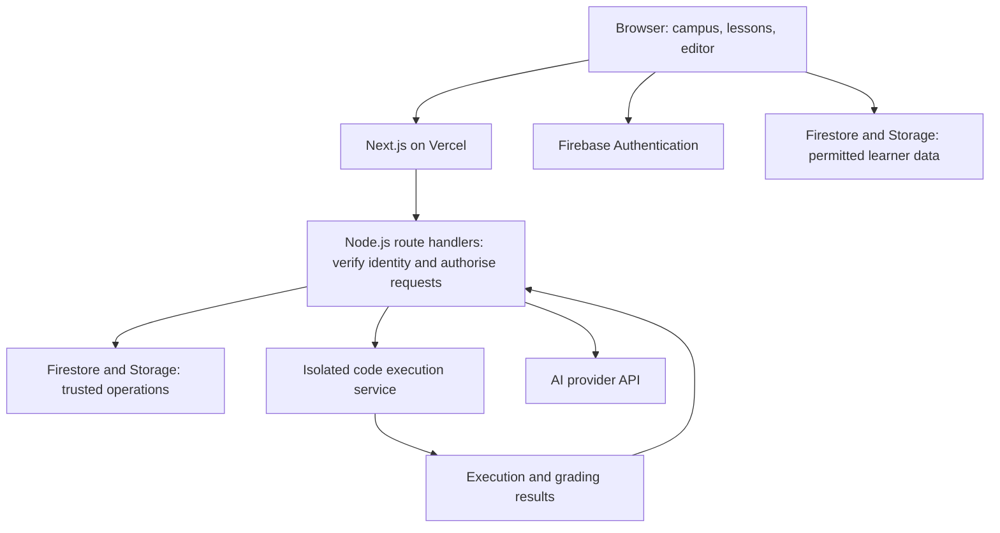

# GuruDev - A Gurukul for Coders and Developers

**Project brief and implementation plan**  
**Prepared:** 14 November 2026  
**Stage:** Product planning; this document describes the proposed website.  
**Historical foundation:** [Ancient Indian Gurukul research](GURUKUL_RESEARCH.md).

## 1. What GuruDev does

GuruDev is an all-in-one place where people learn programming, learn to build with AI through vibe coding, run code in online compilers, and solve real coding problems. Its identity comes from the ancient Indian Gurukul tradition: learning through a teacher's guidance, thoughtful questions, sustained practice, and the application of knowledge.

The website opens into a quiet, hand-drawn Gurukul campus. Different huts represent different subject Gurukuls. Clicking or tapping a hut takes the learner into that Gurukul's courses, tools, and activities. The campus is the main navigation system, and each destination is a useful learning space with its own URL.

**Brand meaning:** “Guru” expresses guidance and mentorship; “Dev” refers to coders and developers. GuruDev is the project's brand name, not a claim that software development was an ancient discipline.

**Suggested tagline:** “Learn. Build. Practice. Your developer Gurukul.”

## 2. Requirements established for this project

- Use React, Next.js, and Node.js, starting with the latest stable versions available when implementation begins.
- Host the website on Vercel.
- Use Firebase for accounts, saved learning data, and other backend services.
- Take visual and educational inspiration from ancient Indian Gurukulas and ashram life.
- Use a hand-drawn style that feels minimal, calm, and premium.
- Bring vibe coding, online code execution, and programming problems together in one website.
- Make multiple Gurukul huts clickable entrances to their corresponding learning spaces.

The hut names, release phases, language coverage, and service choices below are recommended design decisions. “Premium” describes the intended appearance; a paid subscription has not been specified.

## 3. Who the website serves

| Learner | What they should get from GuruDev |
| --- | --- |
| Complete beginner | A clear introduction to programming and small exercises that build confidence. |
| Person learning vibe coding | Guidance on describing requirements, working with AI, understanding generated code, and checking the result. |
| Student preparing for interviews | Structured programming problems, test results, explanations, and a record of improvement. |
| Practising developer | A quick compiler workspace, reference material, and projects for developing new skills. |

Browsing the campus, course descriptions, and reference material should be open. An account unlocks saved progress, saved workspaces, submissions, and metered services such as remote execution and AI help.

## 4. The Gurukul campus and its huts

The campus is an illustrated grove with earth paths, modest huts, and a shared courtyard. A tree provides a visual centre. This is an artistic interpretation of an ancient learning environment; the research document explains which concepts are historical and which are GuruDev's product design.

| Hut / subject Gurukul | Plain-English signboard | What opens inside | Route | Release |
| --- | --- | --- | --- | --- |
| **Vidya Gurukul** | Coding Foundations | Beginner courses, programming concepts, worked examples, and short exercises. | `/gurukul/vidya` | MVP |
| **Shilpa Gurukul** | Vibe Coding & Projects | AI-assisted development lessons, prompt exercises, guided builds, and project reviews. | `/gurukul/shilpa` | MVP |
| **Prayog Gurukul** | Compiler & Playground | Code editor, language selection, standard input, execution results, and saved snippets. | `/gurukul/prayog` | MVP |
| **Abhyas Gurukul** | Coding Problems | Problem collections, sample tests, graded submissions, hints, and solution explanations. | `/gurukul/abhyas` | MVP |
| **Grantha Gurukul** | Reference Library | Searchable notes, syntax references, coding patterns, and curated learning resources. | `/gurukul/grantha` | MVP |
| **Sabha** | Developer Community | Discussions, project sharing, code reviews, and peer learning. | `/gurukul/sabha` | Later release |

These names apply researched Indian terms to modern coding features. The particular collection of huts is created for GuruDev. “Kutir” can be used in supporting copy to describe an individual hut.

### How entering a hut works

1. The learner sees the name and English purpose on the hut's signboard.
2. Hover or keyboard focus reveals a short description; tapping on mobile works without hover.
3. Selecting the hut navigates to its real page, with a brief optional transition.
4. The destination shows a useful first action: start a lesson, open the editor, or choose a problem.
5. A persistent “Back to campus” link keeps the village easy to explore.

Use native links and visible text for the entrances. Provide a parallel “Explore Gurukuls” list for small screens, keyboards, and screen readers. Available huts must be distinguishable from future destinations.

## 5. How learning works

GuruDev's learning loop is **learn -> reflect -> practise -> apply -> discuss -> demonstrate**. It adapts themes found in ancient teaching traditions to modern software education; it is a product framework, not a reconstructed ancient syllabus.

Every substantial lesson should contain:

1. A concrete outcome and a short explanation.
2. A worked example from an instructor.
3. A question that asks the learner to predict or explain something.
4. An exercise they can run or build.
5. Feedback on the result and an explanation of mistakes.
6. A small check of understanding before moving on.

Progress should reflect useful work: completed exercises, independently solved problems, and reviewed projects. Reading time and login streaks can be supporting signals, but mastery comes from demonstrated understanding.

### Example learner journey

A beginner enters Vidya Gurukul and learns variables, conditions, and loops. They open the example in Prayog, change the input, and inspect the output. They then enter Abhyas and solve a related problem. Later, they enter Shilpa to build a small app with AI assistance, applying concepts they have already practised. Their account records where they stopped and what they successfully completed.

## 6. The main features

### Vidya: actual coding knowledge

Start with JavaScript and Python fundamentals, followed by functions, data structures, debugging, basic algorithms, and web development. Courses should have clear prerequisites and a visible progression from concepts to exercises.

Lessons can contain text, diagrams, instructor explanations, and runnable examples. Add video only when it improves the lesson; a video library is not required for the first release.

### Shilpa: learn vibe coding with understanding

Vibe coding here means using natural-language instructions and AI coding tools to help create software, while learning to understand and verify the resulting code.

Teach learners to:

- Turn an idea into a small, specific requirement.
- Give an AI tool useful context and examples.
- Break a build into manageable changes.
- Read generated code and ask for explanations.
- Reproduce bugs, interpret errors, and test fixes.
- Handle configuration and secrets correctly.
- Review changes with Git and explain what the finished project does.

**Example guided build:** a habit tracker. The learner describes the screens, builds the interface, adds validation, connects Firebase authentication and saved data, checks access rules, and tests the main user flow. Completion requires a working result and a short explanation of the important code.

An integrated AI Guide can provide explanations, hints, and suggested edits. Generated changes should be reviewable before the learner applies them. Human mentors, when introduced, can be called Acharyas; the AI Guide should be clearly identified as AI.

### Prayog: compiler and code playground

The workspace should provide a readable editor, a language/runtime selector, standard input, Run and Reset actions, output, errors, and saved snippets. Include execution status and limits so learners can understand a failed run.

Recommended first language coverage: JavaScript and Python through an isolated execution provider. Add C, C++, and Java when the provider integration and grading harnesses have been verified for those languages. Runtime versions shown in the compiler must come from the execution provider's supported-language inventory.

For HTML/CSS/JavaScript mini-projects, offer a separate browser preview on an isolated origin or in an appropriately sandboxed iframe. This preview has different capabilities from the remote compiler.

### Abhyas: real problems and trustworthy feedback

Each problem needs a statement, input/output format, constraints, examples, topic tags, difficulty, and a language-compatible starter template where useful.

“Run samples” checks the visible examples. “Submit” evaluates the solution against private test cases, including edge cases, and returns a verdict such as Accepted, Wrong Answer, Compilation Error, Runtime Error, or Time Limit Exceeded.

Use progressive hints and show an editorial after completion or an explicit request. Save attempts, successful submissions, and explanations. Problem sets should grow from foundations to arrays, strings, maps, recursion, searching, sorting, and further data structures.

### Grantha and the learner's account

The library contains concise, reviewed reference material and links to original documentation. Search should find topics, lessons, problems, and reference entries. A learner dashboard shows their current lesson, saved work, solved problems, and suggested next activity.

## 7. Visual direction

**Design intention:** an ancient Indian learning grove drawn with an illustrator's restraint, combined with the clarity of a modern developer tool.

| Token | Starting colour | Purpose |
| --- | --- | --- |
| Paper | `#F7F1E7` | Main background, lightly textured. |
| Warm surface | `#FFF9F0` | Reading panels and cards. |
| Ink | `#29251F` | Text and primary outlines. |
| Muted ink | `#61594E` | Secondary text, subject to contrast checks. |
| Terracotta | `#9B4D35` | Selected entrances and primary accents. |
| Leaf | `#466047` | Progress and positive feedback. |
| Sand | `#D8C8AA` | Decorative borders and paths. |

These are initial design tokens. Verify contrast for the actual foreground/background pairs before implementation is accepted.

### Illustration and typography

- Draw huts, roofs, trees, paths, and signboards with restrained, slightly irregular strokes.
- Use warm earth, timber, and thatch cues with plenty of open space.
- Keep paper texture faint and decoration concentrated around the campus and section entrances.
- Use a refined serif for headings, such as Lora, and a readable sans-serif such as Inter for UI and body text.
- Use a proper monospace font in the editor. Reserve handwriting for short decorative labels.
- Include optional Devanagari labels where they add character, always paired with readable English descriptions.

The campus carries the richest illustration. Learning and editor pages should prioritise reading, focus, and useful screen space. A dark editor surface can sit within the warm theme if its syntax colours remain legible.

### Layout and movement

Use a responsive 2D composition. On desktop, arrange huts around the courtyard with clear paths. On mobile, present a compact illustration followed by the same entrances as a vertical list.

Keep animations subtle: a signboard response, a short entrance transition, or slight foliage movement. Respect reduced-motion settings. Avoid making animation, dragging, or zooming necessary to navigate.

Use semantic headings, visible focus, sufficiently large targets, and text descriptions for each hut. Lazy-load the editor and heavy learning tools after entering their Gurukul; the campus should open quickly.

## 8. Technology stack and verified versions

The following is a live version snapshot checked on **14 November 2026**. Re-check stable releases when scaffolding the application, then commit the package lockfile for reproducible builds.

| Component | Verified version / choice | Responsibility |
| --- | --- | --- |
| React and React DOM | **19.3.1** | Interactive components and learning workspaces. |
| Next.js | **16.4.6**, App Router | Pages, server rendering, route handlers, and application structure. |
| Node.js | **26.13.1**, current stable LTS | Development and server-side JavaScript runtime. |
| Vercel runtime | **26.x**, currently supported and the documented default | Website deployments and Node.js functions; Vercel manages patch updates. |
| Firebase JavaScript SDK | **13.3.0** | Browser authentication and permitted client data operations. |
| Firebase Admin SDK | **14.5.1** | Trusted server access, token verification, and protected writes. |
| TypeScript | Recommended | Typed application code and shared request/result contracts. |
| Code editor | Monaco Editor or CodeMirror | Editing and syntax support; select after checking mobile usability and bundle size. |

The verified Next.js release supports React 19 through its peer dependencies. Its App Router also includes framework-managed React builds internally; application dependencies should follow the documented stable setup. Firebase Admin's declared Node.js requirement is satisfied by Node 26.

Configure `engines.node` as `"26.x"` and select the same major version in Vercel. The hosting runtime and the compiler's language runtimes are separate: a Node version used to host GuruDev does not determine the version used to execute a learner's program.

## 9. How the system fits together

React supplies the interface. Next.js organises the application and hosts the Node.js backend endpoints on Vercel. Firebase provides identity, persistent data, and file storage. The backend coordinates code execution and AI requests with services designed for those jobs.

A separate execution service is necessary for a credible multi-language compiler. Vercel functions should submit jobs and return results; learner programs run inside an isolated execution environment. A managed Judge0-compatible service is the recommended starting integration. The public Judge0 documentation is a protocol reference, not a selected production service or availability guarantee.

### Accounts and access

Firebase Authentication handles sign-in, starting with Google and email/password. Client requests to protected APIs carry a Firebase ID token. The Node.js backend verifies it, obtains the user ID, and checks ownership or role before doing any privileged work.

Client Firestore and Storage access must also be controlled by security rules. Server code using Firebase Admin bypasses those rules, so each server operation needs its own authorisation checks. Learner, mentor, and admin privileges should be assigned by trusted server administration.

### Running and grading code

1. The editor sends source code, language, and standard input to `POST /api/runs`.
2. The backend checks identity, supported language, input size, and usage limits.
3. It creates a run record and submits an isolated job, receiving the provider's job token.
4. It returns a GuruDev run ID promptly. The interface remains responsive and shows Queued or Running.
5. The browser polls `GET /api/runs/[id]` with backoff. Each request verifies ownership and can refresh status from the provider.
6. The server records completion and returns bounded output, errors, timing, and the verdict.

For a problem submission, the backend loads private tests and uses the appropriate grading harness. Record the problem/test-set version, apply consistent output-comparison rules, and award progress only from trusted grading results. Do not expose hidden test inputs, expected answers, provider credentials, or internal judge tokens in the client response.

Set execution time, memory, output, and concurrency limits supported by the selected runner. Keep network and host-resource access restricted by the execution service. An endless loop must end as a failed run while the website stays usable.

Persist pending jobs and reconcile them through later status requests or a verified, idempotent provider callback. Do not depend on in-memory jobs or unfinished background work continuing after a Vercel response.

### AI help

The browser sends the learner's question and relevant lesson or code context to a protected server endpoint. The backend enforces usage limits, calls the configured AI provider, and streams an explanation or hint back to the interface.

Keep provider keys on the server. Save conversations only according to the chosen product policy. Treat generated code as a suggestion that learners can inspect, run, test, and change. The initial provider/model remains an implementation choice because the requested stack does not specify one.

## 10. Firebase responsibilities and data structure

| Service / collection | Proposed data | Access model |
| --- | --- | --- |
| Firebase Authentication | User identity and sign-in providers. | Managed authentication; verified tokens for backend requests. |
| `users/{uid}` | Public display name and permitted profile preferences. | Owner can edit approved fields; roles managed by trusted administration. |
| `gurukuls/{slug}` | Hut name, purpose, illustration, route, and publication state. | Published entries readable; editor/admin writes. |
| `courses/{id}` and `lessons/{id}` | Outcomes, prerequisites, ordered lessons, exercises, and content versions. | Published content readable; controlled authoring. |
| `problems/{id}` | Public statements, constraints, examples, tags, and supported languages. | Public or signed-in reading according to product policy. |
| `problemTests/{id}` | Hidden inputs, expected outputs, and grading configuration. | Trusted backend only. |
| `progress/{uid}/items/{itemId}` | Resume position and verified completion status. | Owner reads; split permitted resume updates from trusted completion writes. |
| `playgrounds/{id}` and `projects/{id}` | Owner ID, source, language, title, and update time. | Owner access by default; explicit sharing can be added later. |
| `runs/{id}` and `submissions/{id}` | Owner ID, problem/version, job status, results, and timestamps. | Backend writes; owner reads sanitised records. |
| Firebase Storage | Illustrations, course assets, and larger project files. | Public assets separated from protected learner uploads. |

Keep large output, binaries, and archives out of Firestore documents. Use Storage when required, bound code/input sizes, add indexes for real queries, and define retention for old runs. Debounce autosaves and subscribe only to data needed by the current screen.

Trusted course content may use Markdown/MDX. Learner submissions and discussions must be treated as untrusted text rather than executable MDX.

## 11. Supporting pages and endpoints

| Location | Purpose |
| --- | --- |
| `/` | Illustrated campus and text navigation to each Gurukul. |
| `/gurukul/[slug]` | The selected subject Gurukul. |
| `/learn/[courseSlug]/[lessonSlug]` | A lesson with exercises and a link back to its Gurukul. |
| `/problems/[problemSlug]` | Problem, editor, sample runs, and graded submissions. |
| `/projects/[projectId]` | Saved guided-build workspace. |
| `/me` | Learning progress, submissions, and saved work. |
| `/glossary` | Short explanations of the Indian terms used in the interface. |
| `/about` | GuruDev's purpose and ancient Gurukul inspiration. |
| `/admin` | Protected course/problem authoring and publication. |
| `/api/runs` and `/api/runs/[id]` | Create a run and retrieve its authorised status. |
| `/api/submissions` | Start problem grading and record verified outcomes. |
| `/api/ai/help` | Metered, authenticated AI guidance. |

Public content should be server-rendered where useful. Interactive editors and private learner workspaces can load client-side. Keep breadcrumbs and campus navigation consistent across all routes.

## 12. Delivery phases

### MVP: a useful coding Gurukul

- Ship the campus with five working entrances: Vidya, Shilpa, Prayog, Abhyas, and Grantha.
- Include Firebase sign-in and saved learner progress.
- Publish one complete beginner track, one guided vibe-coding project, and a curated starter problem set with genuine grading.
- Support JavaScript and Python execution, saved snippets, and clear error handling.
- Provide a reference library, a glossary, and a basic learner dashboard.
- Include integrated, metered AI help when a provider is configured; core lessons and practice should remain usable during provider outages.
- Ship responsive navigation, accessible entrances, and a protected content-authoring workflow.

### Later releases

Open Sabha for moderated discussions and project sharing. Add human Acharya mentorship, further language runtimes, advanced problem tracks, richer multi-file projects, and collaborative learning when the core experience is reliable.

Subscriptions, paid mentorship, competitions, and certificates are possible future products. Their pricing and requirements should be decided separately; an ancient theme does not determine the business model.

## 13. What a completed MVP must demonstrate

1. Every available hut opens the correct, useful destination on desktop and mobile.
2. The campus can be navigated entirely by keyboard and through its text list.
3. A learner can sign in, complete an exercise, and resume after returning.
4. JavaScript and Python run with accurate results; errors and endless loops terminate cleanly.
5. Problem submissions are checked against private tests and record a trustworthy verdict.
6. One learner cannot read or overwrite another learner's private work or submission data.
7. A slow or unavailable runner/AI provider produces a recoverable state while navigation and editing continue to work.
8. Generated code can be reviewed and tested as part of a guided project.
9. Vercel production deployment works with Firebase's authorised domains and production configuration.
10. The rendered website matches the intended warm, hand-drawn, minimal, premium design.

## 14. Implementation decisions still to settle

Before building the corresponding integration, select the managed code-execution provider, AI provider/model, and editor. Define initial service budgets, exact starter curriculum, problem-set size, and content authorship. Confirm whether Hindi explanations should accompany the first English release.

Use separate Firebase environments for development/preview and production where practical. Configure Vercel server credentials, Firebase authorised domains, deployed rules, and provider credentials before live integration testing. Track execution failures, grading errors, and service latency to keep the learning experience reliable.

## 15. Technical sources

Version checks used the live npm `latest` metadata and Node.js release index. Architecture references come from official product documentation; execution-provider selection remains open.

- [React release metadata](https://registry.npmjs.org/react/latest) and [React DOM release metadata](https://registry.npmjs.org/react-dom/latest).
- [Next.js release metadata and dependency requirements](https://registry.npmjs.org/next/latest).
- [Next.js installation and App Router setup](https://nextjs.org/docs/app/getting-started/installation).
- [Node.js release index](https://nodejs.org/dist/index.json).
- [Vercel supported Node.js versions](https://vercel.com/docs/functions/runtimes/node-js/node-js-versions).
- [Firebase JavaScript SDK release metadata](https://registry.npmjs.org/firebase/latest) and [Firebase Admin SDK release metadata](https://registry.npmjs.org/firebase-admin/latest).
- [Firebase web setup](https://firebase.google.com/docs/web/setup).
- [Firebase ID-token verification](https://firebase.google.com/docs/auth/admin/verify-id-tokens).
- [Cloud Firestore security rules](https://firebase.google.com/docs/firestore/security/get-started).
- [Judge0 CE execution API documentation](https://ce.judge0.com/).
